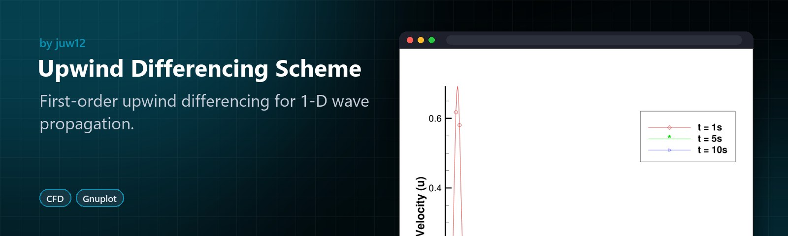

<!-- HERO:START -->

  

  <b>First-order upwind differencing for 1-D wave propagation.</b> 
  A computational fluid dynamics study of upwind differencing, with plotted results.

  <a href="#see-it-in-action">See it in action</a> ·
  <a href="#highlights">Highlights</a> ·
  <a href="https://github.com/juw12">More by juw12</a>

  
  
  

<table>
  <tr>
    <td width="33%" valign="top">
      <b>Upwind differencing</b> 
      A first-order explicit scheme for the 1-D wave equation.
    </td>
    <td width="33%" valign="top">
      <b>Plotted results</b> 
      Solutions at several time levels, plotted with Gnuplot.
    </td>
    <td width="33%" valign="top">
      <b>Compare schemes</b> 
      Pairs with the Explicit MacCormack study.
    </td>
  </tr>
</table>

## See it in action

   
  Upwind Differencing Scheme in use

<!-- HERO:END -->

## About

The one dimensional wave propagation equation is given by 

where the initial conditions are to be stated by

Dx is fixed to a value of 0.01, while u’s and dt’s values are given by 0.09 and 0.01

The solution by the first order backward differencing scheme accurate in first order in time and space is to be given by the equation below.

where the scheme is stable for C ≤1, having an order of accuracy of [∆𝑡,∆𝑥].

## License

Released under the [MIT License](LICENSE) © 2026 Juwen Lie. Contributions are welcome under the same license; see the [contributing guide](https://github.com/juw12/.github/blob/main/CONTRIBUTING.md) and [Code of Conduct](https://github.com/juw12/.github/blob/main/CODE_OF_CONDUCT.md).
